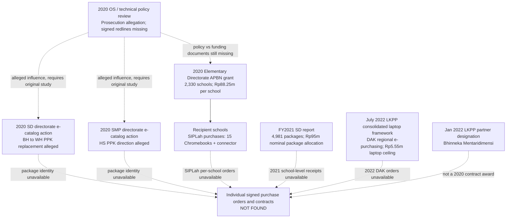

# Chromebook procurement — channel-aware evidence audit (Milestone 006/007)

**Status:** code and private Nocturnal interoperability pass. Public-source references
are not judicial findings, source-content authentication, or a forensic audit. No
signed procurement appointment, package identifier, school purchase order, or
supplier contract has yet passed a primary-document identity check.

This is the first operational answer to a concrete question: **were policy setting,
budget transfer, school ordering, directorate e-catalog purchasing, and 2022 DAK
framework operations the same transaction?** The primary records recovered so
far show *multiple distinct routes*. None of the routes may automatically inherit
the others' prices, signers, vendor authorizations, or legal allegations.

## Purchase-channel map



The 2020 ministry's October announcement says **the school itself** purchased a
subset of its grant-funded items via SIPLah, with routers/projectors procured by
e-catalog. The July 2025 prosecution release alleges separately that on June 30
2020 elementary director Sri Wahyuningsih replaced PPK identified as BH with
PPK WH and that a PPK action involving PT Bhinneka followed; an SMP-specific
PPK identified as HS was also alleged. This is **not** independent confirmation
that a person with those initials signed or executed a particular order.
Even an identical laptop specification is **not** a common package number.

### Price and outcome boundaries

- **2020 APBN school grant** — Rp88.25m is a *per-school program allocation*,
  not a laptop unit price. The ministry said 2,330 schools were programmed.
- **2021 SD output self-report** — 4,981 packages, with Rp95m stated nominal
  assistance per package and Rp471.685757bn described for implementation. The
  latter is a source-reported program figure, not invoice-level reconciliation.
  The same report also has other expenditure tables: do not invent equivalence.
- **2022 LKPP Circular 9** — Rp5.55m is a specified **one-laptop ceiling**
  within a consolidated 2022 DAK e-catalog procurement framework, excluding
  shipping but including listed device-management terms. It is **not** an
  established 2020 kit purchase price and cannot be projected backward.
- **2022 marketplace partner designation** — LKPP Decision 6/2022 named
  PT Bhinneka Mentaridimensi as a digital shop partner on 26 Jan 2022. It
  establishes a 2022 designation, not a signed 2020 procurement award.
- **2025 BPKP statement** — reported risk/governance reviews conducted jointly
  with Education Ministry inspectors in late 2023–2024, including site sampling.
  The published statement does not supply an individualized criminal loss,
  signed appointment, or itemized school performance assessment.

### How to run

```bash
PYTHONPATH=src python -m cite_refinery.legal_codex_purchase_trace \
    examples/legal_codex_chromebook_purchase_channels_006.json \
    --output /tmp/purchase_channels.json \
    --packet /tmp/purchase_channels_graph.json

PYTHONPATH=src python -m unittest discover \
    -s tests -p 'test_legal_codex*.py' -v
```

The packet uses `cite_refinery.semantic_graph.v1`. All links are candidate
`REPORTS` and `CONTEXT_FOR`, *not* causal, guilt, ownership, appointment or
payment relations. Nocturnal's real analyzer processes the separate
`legal_codex_procurement_actor_leads_007.json`, keeping initials-only PPK
references unresolved.

## Evidence leads and capture scope

1. Contemporaneous Ministry SD assistance statement, 23 Oct 2020:
   https://ditsd.kemendikdasmen.go.id/artikel/detail/direktorat-sekolah-dasar-salurkan-bantuan-tik-untuk-asesmen-kompetensi-minimum-akm
2. 15 July 2025 Attorney General prosecution release PR-624, originally
   mirrored by multiple public prosecutors, but attempts to capture the chosen
   mirrors returned HTTP 404 (indexed-text evidence only):
   https://kejati-kepulauanbangkabelitung.kejaksaan.go.id/conference/news/6463/read
3. January 2022 SD Directorate FY2021 performance report:
   https://ditsd.kemendikdasmen.go.id/upload/filemanager/download/LAKIP%20DIT.SD%20TAHUN%202021_TTD.pdf
   Indexed text provided the output and spending claims; Nocturnal live PDF
   acquisition timed out, and original-page image inspection was unavailable.
4. LKPP Circular 9/2022, primary source PDF with separate 2022 DAK scope,
   Nocturnal private SHA+selected-page receipt in workflow 42830489546:
   https://jdih.lkpp.go.id/regulation/download/surat-edaran-kepala-lkpp-nomor-9-tahun-2022/1
5. LKPP Decision 6/2022, vendor as marketplace partner, Nocturnal private
   original HTML response receipt in workflow 42830489546:
   https://jdih.lkpp.go.id/regulation/keputusan-deputi-ii/keputusan-deputi-ii-nomor-6-tahun-2022
6. BPKP 11 June 2025 overview of 2023–2024 review:
   https://bpkp.go.id/id/unitKerja/66/siaranPers/djP/pengawasan-bpkp-atas-pengadaan-alat-tik-kemdikbudristek

Nocturnal validates **bytes and extraction**, not the underlying truth of a
statement. Its raw captured snapshots are stored only in a **private** GitHub
Actions artifact with **30-day retention**; cited receipts in the public
dataset are not substitute originals.

## 18 missing record categories

The actionable collection list is `required_records` in the fixture. Its
highest-evidence categories are:

- Signed original 2020 SD PPK appointment/revocation for BH and WH, original
  2020 SMP PPK appointment for HS, with date and legal delegation.
- DIPA/RUP/package identifiers keyed to every APBN grant/e-catalog commitment,
  with the buyer or school that actually executed each transaction.
- Signed technical study and successive revisions, including who authored,
  approved, and transmitted the final specification.
- Actual 2020 SIPLah school purchase orders, 2020 SD/SMP e-catalog orders,
  supplier acceptances, and device serial-number delivery receipts.
- School-level 2021 invoice and acceptance records reconciling 4,981 reported
  packages; independently sampled usage outcomes.
- 2022 DAK consolidated contract/purchase orders and negotiated price evidence;
  **no** inference from the LKPP framework alone to specific transactions.

## Named-player limitations

The 2025 press release refers to PPK **BH**, **WH** and **HS** only by initials.
Nocturnal must not infer their full identities. The Nadiem trial index separately
names **Wahyu Haryadi** in its later evidence inventory. Those two mentions
might be relevant for follow-up, but their identity match is **not proven**,
and the court's evidence-custody disposition is **not proof of collusion**.
The `legal_codex_procurement_actor_leads_007.json` fixture enforces this
separation; no cross-case edge is accepted. The legal role of PPK does not
substitute for a named official's signed, date-specific appointment or for
a specific order's authenticated execution.

### Current nonpassing milestones

Independent original procurement appointment/contract capture, source and
case identity crosswalk, unbiased full population sampling, independent fiscal
loss estimation, and expert adjudication of contradictory legal arguments.

The separate GitHub full test workflows may still fail on unrelated optional
dependencies; the dedicated Legal Codex and Nocturnal cross-repository CI
gates must pass before either PR is considered merge-ready.


## Milestone 008 — signed PPK appointment and purchase order hunt

Detailed **reported instrument identifiers**, prosecution/court disagreement, and unverified
judicial exhibit inventory:
\`examples/legal_codex_signature_chain_008.json\`, analyzed by
\`src/cite_refinery/legal_codex_signature_chain.py\`.

The actionable official-access requests are prepared, **NOT SUBMITTED**, in
\`docs/LEGAL_CODEX_ORIGINAL_RECORD_REQUESTS_008.md\`. They specify exactly what
is missing from ministry PPID, LKPP/SiRUP/e-catalog and Jakarta court: a complete
signed 2020 KPA/PPK decision (including the June 30 change), original full e-order
IDs, corresponding SD/SMP contract signatories, and the full 149 trial judgment.
These require the legitimate applicant's government-form identity information
and permitted disclosure procedures; no user identity details were supplied.

The reported instrument leads must remain distinct:
- "nomor 4" in Bambang's Feb 2026 reported resignation testimony is incomplete.
- \`15004/C3/KPA/VI/KP/2020\` refers to a **June 8** SD financial appointment
  decree in a third-party 2020 PHBS school-aid guide, not the June 30
  Chromebook PPK replacement.
- \`26721/C3/KPA/IX/TIK/2020\` is an October 2020 KPA assistance guideline
  cited by a March 2021 **official Pati** administrative response, which says
  schools made their own SIPLah purchase and payment decisions.
- \`3535/C4/LK/2020\` and \`3945/C4/LK/2020\` are reported Nov 2020 **SMP**
  purchase-order addenda in a third-party court-document copy, not the original
  June 30 SD e-order.
- \`149/Pid.Sus-TPK/2025/PN Jkt.Pst\` is the separately reported trial
  docket for Sri Wahyuningsih; its full original signed judgment and itemized
  exhibit set have not yet been obtained.

Nocturnal private CI run \`42834469206\` successfully captured and verified
original **webpage bytes** for the official Pati response, Detik courtroom
report and Hukumonline legal commentary (all three source-specific SHA receipts
are retained in the fixture). This is verifiable provenance of what the
**publishers** printed—not of the underlying appointment instrument, witness
testimony's truth, signed court judgment, or purchase authorization.

The account of why the June 30 replacement happened is contested. Prosecution
accounts attribute it to failure to carry out Chromebook-related purchasing
instructions; Hukumonline's report of the Sri trial panel describes a voluntary
Bambang resignation, replacement with certified Wahyu Haryadi during deadline
pressure, and criticism of the absence of a documented handover. Preserve
these as **different attributed accounts** pending original official judgment
and personnel-file records.

Tests assert the graph cannot promote a reported document reference into an
accepted signer, a reported judicial narrative into primary signed evidence,
or either account into an accusation of culpability.
